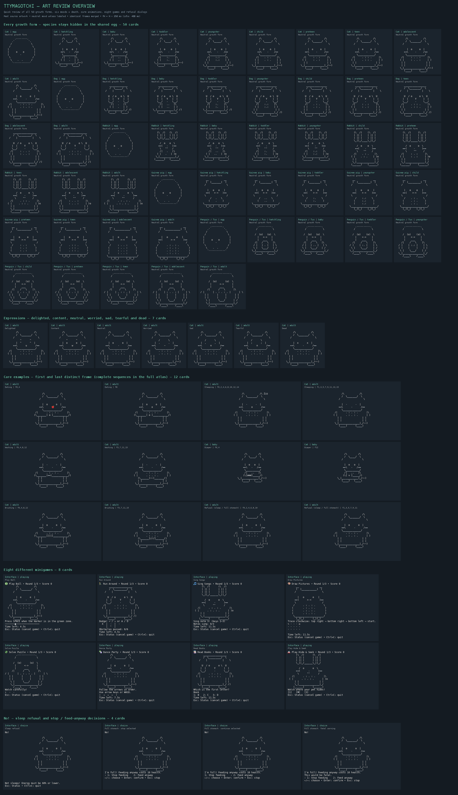

# ttymagotchi 🐾

An animated virtual pet for your terminal. Hatch a mystery egg, raise a cat, dog,
rabbit, guinea pig or penguin, and care for it through ten growth stages.

**This is a fork of [Termagotchi](https://github.com/ezeoleaf/termagotchi) by
[Eze Olea Figueroa](https://github.com/ezeoleaf), based on v0.2.0.** The original
project, history and MIT license are preserved. ttymagotchi adds interactive games,
animated care, five species, realistic care timing and five interface languages.

## Features

- Five randomly assigned species, each with ten growth forms; all start in the same mystery egg.
- Random names drawn from the 100 most common Dutch first names.
- Large animated ASCII pets with blinking, moving ears/tails and expressions that follow Happiness.
- Eight distinct playable minigames; performance determines rewards.
- Animated feeding, sleeping, washing, diaper changes and brushing.
- Health consequences for starvation, overfeeding and poor hygiene; sustained good care restores health.
- A clear animated **No!** when your pet is full or too energetic to sleep.
- Discrete diaper accidents, gradual adult brushing needs, and speed settings from a week to five minutes.
- English, Nederlands, Français, Español and Deutsch, switchable in Options.
- Keyboard navigation, one-percent status bars, event history and saved offline progression.

## Installation

### Linux packages (Arch, Debian / Ubuntu, Fedora)

Download the matching **x86_64** installer from
[Releases](https://github.com/rene-timmermans/ttymagotchi/releases/latest), then run:

```sh
# Arch Linux / SteamOS desktop mode (where system package installation is enabled)
sudo pacman -U ./ttymagotchi-0.3.0-1-x86_64.pkg.tar.zst

# Debian / Ubuntu
sudo apt install ./ttymagotchi_0.3.0-1_amd64.deb

# Fedora
sudo dnf install ./ttymagotchi-0.3.0-1.x86_64.rpm
```

Packages install `/usr/bin/ttymagotchi` and an application menu entry that opens a
terminal. A terminal with UTF-8, emoji support and a monospace font is recommended.
Check downloaded files against the release's `SHA256SUMS` with `sha256sum -c`.
These packages belong to this fork; the original Termagotchi AUR/Homebrew packages
continue to install the upstream project.

### Portable Linux binary

This also works without modifying the system, including on Steam Deck:

```sh
tar xzf ttymagotchi-0.3.0-linux-amd64.tar.gz
mkdir -p ~/.local/bin
install -m755 ttymagotchi-0.3.0/bin/ttymagotchi ~/.local/bin/ttymagotchi
~/.local/bin/ttymagotchi
```

### From source

Requires Go 1.24 or newer:

```sh
git clone https://github.com/rene-timmermans/ttymagotchi.git
cd ttymagotchi
make build
./bin/ttymagotchi
```

Or use `go install github.com/rene-timmermans/ttymagotchi/cmd/ttymagotchi@latest`.
The source supports Go's terminal platforms; this release's native installers and
portable executable target Linux x86_64.

## Usage

Run `ttymagotchi` in a terminal. `ttymagotchi --version` prints the build version.

### Controls

| Key | Action |
| --- | --- |
| Esc / Ctrl+S | Return to Status |
| Ctrl+F | Feed |
| Ctrl+P | Play |
| Ctrl+L | Sleep |
| Ctrl+Y | Hygiene |
| Ctrl+O | Options: language and speed |
| Ctrl+E | Event history |
| Ctrl+H | Help and care guidance |
| Ctrl+R | Restart with a new random egg and name (confirmation required) |
| Ctrl+C | Save and quit |

### Navigation

Use arrows and Enter in menus. On Status, select a bar and press Enter: Hunger
opens Feed, Happiness opens Play, Energy opens Sleep, and Hygiene opens care.
Cleanliness starts washing directly; Diaper or Brushing starts the appropriate
care action. Health and Recovery open care guidance.

Each minigame displays its controls. Esc cancels an unfinished game without its
rewards or energy cost. During food/care, Esc finishes the selected action once
and returns to Status. In the full-stomach decision, Esc stops unconfirmed feeding.

## Game Mechanics

### Stats

| Stat | Meaning and care |
| --- | --- |
| Hunger | 0% is full; 100% is starving. Feed before it reaches 90%. |
| Happiness | Play games; facial expressions become sadder as this falls. |
| Health | 0% means death. Overfeeding, starvation and neglected hygiene cause damage. |
| Energy | Sleeping restores it. Above 60%, your pet refuses to sleep. |
| Hygiene | Overall hygiene indicator, combining the active care needs. |
| Cleanliness | Wash your pet to restore this to 100%. |
| Diaper | Active during stages 1–3. Four or five accidents per normal day, each costing 35 points. |
| Brushing | Replaces Diaper from stage 4. Declines slowly: about seven normal days from 100 to 0. |
| Recovery | Shows whether care is sufficient for gradual health recovery. |

Bars display one-percent changes. At 20% or less, neglected cleanliness and the
active Diaper/Brushing need damage health, increasingly strongly toward zero.
Starvation starts damaging health at Hunger 90%. Overfeeding costs at least five
health, increasing with excess food. At Hunger 0, the pet protests and shows the
cost before you choose **Stop feeding** or **Feed anyway**; Stop is the default.
A potentially fatal choice is explicitly marked.

Keep Happiness, Energy and active hygiene needs at least 40%, and Hunger no higher
than 60%, continuously to recover one health point every 24 minutes at normal
speed. A lapse or overfeeding resets recovery progress. Death is permanent for
that pet; restarting creates a new egg. Sleep and successful games can also award
health according to the selected activity.

### Life Stages

| Stage | Form | Age in days |
| --- | --- | --- |
| 1 | Egg | 0 |
| 2 | Hatchling | 1 |
| 3 | Baby | 2 |
| 4 | Toddler | 3 |
| 5 | Youngster | 4 |
| 6 | Child | 5 |
| 7 | Preteen | 7 |
| 8 | Teen | 9 |
| 9 | Adolescent | 12 |
| 10 | Adult | 14 |

A mystery egg hides the species until hatching. A new pet randomly becomes a cat,
dog, rabbit, guinea pig or penguin (Tux). Growth follows elapsed calendar days;
the speed setting adjusts needs and their health effects. Diaper care ends after
the Baby stage; Brushing takes its place at Toddler.

### Food Types

Apple, Pizza, Salad, Burger, Ice Cream, Carrot, Chocolate and Steak offer different
nutrition, Happiness, Energy and weight effects. The Feed menu shows exact values.
Feeding animates food held at the mouth and the pet chewing it. Pay attention
to nutrition compared with remaining Hunger to avoid overfeeding.

### Games

Every Play activity triggers its own three-round minigame:

| Activity | Challenge |
| --- | --- |
| Play Ball | Press Space when the marker reaches the target zone. |
| Run Around | Dodge obstacles with Left/Right or A/D. |
| Sing Songs | Select the requested notes with 1–3. |
| Draw Pictures | Trace an outline clockwise with arrows or WASD. |
| Solve Puzzle | Remember and repeat a hidden arrow sequence. |
| Dance Party | Follow the displayed arrows. |
| Read Books | Choose the first letter of a localized word with 1–3. |
| Play Hide & Seek | Follow shuffled boxes and choose with 1–3. |

Score scales Happiness, Health and weight rewards. Completing a game costs the
activity's listed Energy; canceling an unfinished game applies no result.

### Sleep Options

Choose an option in Sleep to restore the listed Energy and Health. Your pet closes
its eyes, settles down and displays animated Zzz. With Energy above 60%, it shakes
its head and says **No!**; no sleep reward is granted.

## Tips for Success

- At the default 50% speed, Hunger takes eight hours to go from full to starving: plan roughly three meals a day.
- Use food portions that fit the remaining Hunger rather than repeatedly feeding a full pet.
- Keep care needs above 40% for sustained recovery; attend to hygiene before it falls to 20%.
- A diaper accident is a sudden 35-point drop, rather than a continuously draining timer.
- Play for Happiness and watch your pet's expression for an early sign of neglect.
- Set a slower pace in Options if you will be away; offline time still counts.

## Configuration

Settings and your pet are stored in the platform's user configuration directory:
`~/.config/ttymagotchi/config.yml` on Linux (or `$XDG_CONFIG_HOME/ttymagotchi/config.yml`).
Language, speed and care progress persist automatically. On first use after renaming,
if no ttymagotchi save exists, an existing `termagotchi/config.yml` is imported.
The old save remains untouched; subsequent saves use the new directory.

In Options, Left/Right or +/- adjusts speed from 0 to 100:

| Speed | Time for Hunger 0 → 100% |
| --- | --- |
| 0% | One week |
| 50% (default) | Eight hours |
| 100% | Five minutes |

Intermediate settings interpolate geometrically. Other need changes, diaper
schedules, health damage and recovery scale with this pace. Animation playback
duration stays the same. Languages switch immediately and save with your pet.

## Screenshots



[Complete PNG atlas](docs/gallery/all-art.png) · [Cat](docs/gallery/cat.png) ·
[Dog](docs/gallery/dog.png) · [Rabbit](docs/gallery/rabbit.png) ·
[Guinea pig](docs/gallery/guinea_pig.png) · [Penguin](docs/gallery/penguin.png)

The full 12,000 × 20,012 pixel atlas contains 1,852 distinct labeled cards covering
4,550 animation-frame samples. Identical frames are grouped and labeled with their
frame numbers. It includes all 50 growth forms, six living expressions plus death,
idle and care frames, food icons, minigame screens and refusal choices. The original
upstream sprites are included in a separately labeled legacy section.
This is a static frame review, rendered directly from the game's ASCII functions.

## Development

```sh
make build
go test -race ./...
go vet ./...
go build -tags artgallery ./cmd/artgallery
python3 scripts/smoke_test.py bin/ttymagotchi egg nl
```

Regenerate the atlas with `python3 scripts/render_gallery.py` (Go, Pillow,
DejaVu Sans Mono and a supported color emoji font). This tool never opens or
changes your personal pet save. Tests use isolated configuration directories.

Native release builds use `python3 scripts/prepare_release.py`, then
`sh packaging/build.sh debian|fedora|arch dist dist` in the corresponding build
environment with `dpkg-deb`, `rpmbuild` or `makepkg`. The Arch PKGBUILD and RPM recipe
package the same static, tested executable as the Debian package. Release CI builds
all three installers and verifies installation before publishing a versioned release.

### Project Structure

- `cmd/ttymagotchi/`: terminal application entry point.
- `internal/app/`: simulation, pet art, animation, UI, minigames and locale catalogs.
- `internal/config/`: persistence and legacy save import.
- `cmd/artgallery/`, `scripts/`: optional gallery exporter, renderer and terminal smoke test.
- `packaging/`: native package recipes, staging and terminal application entry.
- `docs/gallery/`: review PNGs and generation manifest.
- `.github/workflows/`: verification and tagged package releases.

### Dependencies

Go modules: [tview](https://github.com/rivo/tview),
[tcell](https://github.com/gdamore/tcell),
[uniseg](https://github.com/rivo/uniseg) and
[yaml.v3](https://github.com/go-yaml/yaml). The Linux release executable is built
with CGO disabled and requires no separate Go installation.

## License

MIT, inherited from Termagotchi. See [LICENSE](LICENSE), including the original
copyright notice: Copyright (c) 2025 Eze Olea Figueroa.

## Contributing

Issues and pull requests for this fork are welcome here. For the original project,
please use [the upstream repository](https://github.com/ezeoleaf/termagotchi).
Run the Go checks and relevant terminal smoke tests before submitting a change.
The maintainer requests explicit confirmation before publishing each future change;
see [AGENTS.md](AGENTS.md).

## Acknowledgments

- **Eze Olea Figueroa** for creating [Termagotchi](https://github.com/ezeoleaf/termagotchi), its original game, ASCII art and MIT-licensed foundation.
- Rene Timmermans for the ttymagotchi fork's direction and expanded care, animation and game design, implemented with Codex assistance.
- [Nederlandse Voornamenbank / Meertens Instituut](https://nvb.meertens.knaw.nl/downloads/Top_eerste_voornamen_NL_2022.zip) for the 2022 first-name frequency data (male/female totals combined for the 100-name list).
- The maintainers of the terminal UI, Unicode and YAML libraries listed above.
